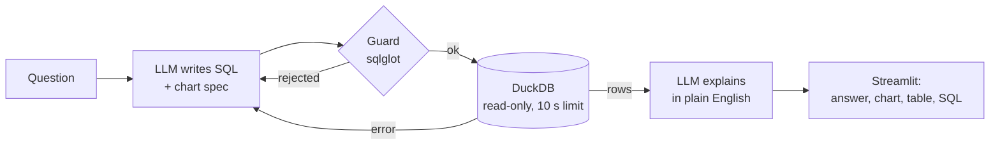

# Ask Your Data: a text-to-SQL agent with guardrails

<!-- RESULT -->

## Problem

Business teams have questions like "which segment brought in the most revenue in 2011?" and an analyst queue between them and the answer. A text-to-SQL agent can close that gap, but only if it can be trusted. The agent must:

- never write to or leak from the database
- stop runaway queries
- say when it can't answer
- be measured against known answers rather than demoed on lucky questions

## Data

The database comes from my [retail customer analytics](https://github.com/gaurang2-6/retail-customer-analytics) project. It is built from the [UCI Online Retail II](https://archive.ics.uci.edu/dataset/502/online+retail+ii) data: about 1 million cleaned order lines from a UK online gift retailer, December 2009 to December 2011, in GBP.

The agent sees 13 tables:

- **Line-level:** `sales`, `returns`
- **Customer-level:** `rfm`, `customer_first_month`
- **Summaries:** monthly KPIs, cohort retention, RFM segments, revenue concentration, and others

Scratch and raw tables are dropped from the copy the agent uses.

## Approach



**A LangGraph state machine** ([askdata/graph.py](askdata/graph.py)):

- The model returns `{sql, chart, rationale}` as schema-validated JSON (structured outputs, so the response always parses). It runs on Claude ([askdata/llm.py](askdata/llm.py)) or Gemini ([askdata/gemini.py](askdata/gemini.py)) behind the same two-method interface.
- If the guard or the database rejects the query, the error goes back to the model, which gets up to two retries.
- API failures stop at once rather than retrying.

**Two independent locks.** Either lock alone blocks every write and file read in the tests.

1. **Guard** ([askdata/guard.py](askdata/guard.py)): parses the SQL with sqlglot and allows exactly one `SELECT`. It allows only the 13 tables (or CTEs over them) in the `main` schema. It rejects table functions such as `read_csv`, and functions that touch files, settings or the environment. Each rejection says why, so the model can fix the query.
2. **Executor** ([askdata/db.py](askdata/db.py)): opens DuckDB with `read_only=True` and `enable_external_access=false`, then sets `lock_configuration`, so a query cannot turn file access back on. A timer interrupts any query after 10 seconds, and results are capped at 1,000 rows.

**Schema context.** The model sees column names and types, plus a one-line meaning for each table. The notes cover:

- an order is a distinct invoice
- `customer_id` is NULL for guest checkouts
- December 2011 is a partial month
- percentages run from 0 to 100

**Evaluation** ([eval/](eval/)):

- **Test set:** 30 business questions, each with a hand-written gold query. There are 10 easy (one summary table), 13 medium (filters and grouping) and 7 hard (joins, subqueries, definitions the model must work out).
- **Metric:** execution accuracy. The agent's result must have the same rows as the gold result. Every gold column must match one of its columns, row by row:
  - numbers within 0.5%
  - text ignoring case
  - dates by day
- **Allowed:** extra columns, different names and different column order.

## Results

<!-- EVAL -->

## Recommendations

- **Use it for the long tail, not the dashboard.** The headline KPIs already live in summary tables, and the agent finds them. Its value is the one-off question ("revenue per customer in countries with at least 10 customers") that would otherwise wait in a queue.
- **Keep the SQL visible.** Every answer shows its query and the model's one-line rationale, so an analyst can check the logic in seconds. Misses in the eval are wrong definitions, not invented numbers.
- **Grow the test set from real questions.** Every question a user flags as wrong should become a test case with a gold query. Accuracy on that set, not on a demo, is the number to watch before widening access.
- **Keep both locks.** The guard gives the model useful feedback. The read-only, no-file-access connection is the real security boundary, and it holds even if the parser is fooled.

## How to run

```bash
python -m venv .venv && source .venv/bin/activate   # Windows: .venv\Scripts\activate
pip install -r requirements.txt

# Build data/retail.duckdb: downloads the UCI file (about 45 MB) and runs the SQL in sql/
python scripts/build_db.py
# or copy it from a local checkout of retail-customer-analytics:
# python scripts/build_db.py --from ../retail-customer-analytics/reports/retail.duckdb

pytest -q                                  # 60 tests, no API key or data needed

export GEMINI_API_KEY=...                  # free key from aistudio.google.com
export ASK_PROVIDER=gemini                 # or ANTHROPIC_API_KEY=... with the default claude
streamlit run app.py
python eval/run_eval.py                    # writes reports/eval_results.md and .csv
```

Set `ASK_MODEL` to try another model, or pass `--provider` and `--model` to `run_eval.py`.

## Demo

<!-- DEMO -->

## Project layout

```
askdata/   guard.py (SQL checks), db.py (read-only executor, schema context),
           llm.py + gemini.py (model calls), graph.py (LangGraph agent), scoring.py (execution accuracy)
eval/      questions.yaml (30 questions + gold SQL), run_eval.py
sql/       the cleaning and modelling SQL from the retail project
scripts/   build_db.py
tests/     guard, executor, scoring, Gemini adapter and agent tests with a stub model and a tiny database
app.py     Streamlit UI
```

MIT licensed.
